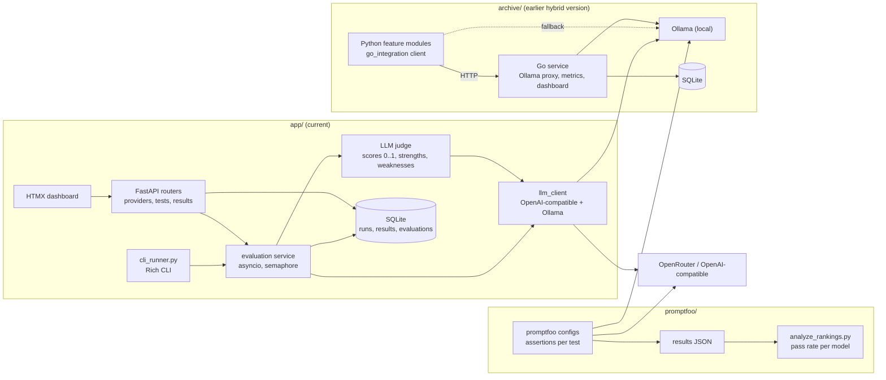

# llm-evals

Compare language models on the same tasks and keep the results reproducible.

`llm-evals` runs a fixed set of test prompts against models from different providers (local Ollama, OpenRouter, OpenAI-compatible APIs), stores every request and response, and scores the answers with assertions and an LLM judge. The goal is to answer "which model is good enough for this task, at what latency and cost" with data instead of impressions.

This is a personal project. It is a working prototype, not a hardened product. See [Status and limits](#status-and-limits).

## What is in the repository

The repository holds three layers, from newest to oldest:

| Path | What it is | State |
|---|---|---|
| `app/`, `cli_runner.py`, `tests/**/*.json` | FastAPI + HTMX + SQLite app: provider registry, test runs, LLM-judge scoring, dashboard, Rich CLI | Current. Boots and passes the smoke tests. |
| `promptfoo/` | [promptfoo](https://www.promptfoo.dev/) configs (text, code, reasoning, SEO writing) plus a script that ranks models across runs | Configs validate. Runs need your own keys or a local Ollama. |
| `archive/` | Earlier hybrid version: feature-based Python modules plus a Go service (Ollama proxy with pooling and retry, SQLite repository, Prometheus metrics, WebSocket dashboard) | Kept for reference. The Go service builds and mostly passes its tests; the Python side is not maintained. |

The "hybrid Python-Go" design lives in `archive/`. The current `app/` is Python only and does not call the Go service.

## Architecture



How a run works in `app/`:

1. A test run selects test configs (prompts from `tests/**/*.json`) and models.
2. Every config-model pair becomes a `TestResult`. OpenRouter calls run in parallel (limit `MAX_CONCURRENT_TESTS`). Ollama calls run one at a time so local models do not compete for memory.
3. Response text, latency, token count and the raw provider payload are stored.
4. If a test config has an evaluation prompt, a judge model (Gemini 2.5 Flash Lite via OpenRouter) returns structured JSON that is stored as an overall score (0 to 1) plus accuracy and relevance scores, strengths, weaknesses and suggestions. The judge model is hard-coded in `app/services/evaluation.py`.

Metrics per result: response time, tokens used, judge scores. The `cost` column exists in the schema but is not populated yet. Test types: text generation, code generation, reasoning, vision, math, creative.

## Quickstart

Requires Python 3.12 and [uv](https://docs.astral.sh/uv/). Ollama is optional; without it only OpenRouter models are usable.

```bash
git clone https://github.com/niclasedge/llm-evals.git
cd llm-evals
cp .env.example .env              # add OPENROUTER_API_KEY to use OpenRouter models

uv venv --python 3.12 && source .venv/bin/activate
uv pip install -r requirements.txt

python init_db.py                 # create the SQLite DB and load the 12 bundled test configs
python run.py                     # dashboard at http://localhost:7500, API docs at /docs
```

CLI instead of the dashboard:

```bash
python cli_runner.py list-models
python cli_runner.py list-tests
python cli_runner.py run --help
python cli_runner.py results
```

promptfoo comparison (needs Node.js and pnpm):

```bash
cd promptfoo
pnpm install
pnpm exec promptfoo eval -c configs/basic_text_quick.yaml
pnpm exec promptfoo view
```

Tests:

```bash
python -m pytest tests/test_smoke.py        # app boot, /health, seeding of the bundled test definitions
cd archive/go-service && go test ./tests/database ./tests/integration ./tests/monitoring ./tests/unit ./tests/unit/devtools
```

The Docker files (`Dockerfile`, `docker-compose.yml`) are included but were not verified for this snapshot.

## Example result

`results/basic_text_quick_results.json` is a small raw promptfoo export: two questions, one local model (Gemma3 1B via Ollama).

| Question | Assertion | Outcome | Latency |
|---|---|---|---|
| What is the capital of France? | `contains Paris` | passed (`Paris.`) | 980 ms |
| What are the three primary colors? | `contains-all red, blue, yellow` | failed (`Red, Yellow, and Blue.`) | 951 ms |

The second failure is a false negative: the answer is correct, but the assertion is case-sensitive. That is the main weakness of string assertions and the reason the app adds an LLM judge.

`promptfoo/model_rankings.json` is the output of `analyze_rankings.py` over several runs from October 2025 and ranks 34 models by assertion pass rate. Top of the list:

| Rank | Model | Pass rate | Tests |
|---|---|---|---|
| 1 | Claude Sonnet 4.5 | 87.1 % | 31 |
| 2 | Gemini 2.5 Flash Lite | 84.9 % | 33 |
| 3 | Qwen3 8B (local) | 83.9 % | 31 |

Read this as a demonstration of the output format. About 30 tests per model is too few to separate models that are a few points apart. The `avg_latency_ms` column in that file is not reliable (single-digit milliseconds for remote models point at cache hits); do not use it.

## Configuration

| Variable | Default | Purpose |
|---|---|---|
| `OPENROUTER_API_KEY` | none | OpenRouter models and the LLM judge |
| `OPENAI_API_KEY` | none | OpenAI-compatible endpoints |
| `OLLAMA_BASE_URL` | `http://localhost:11434` | Local models |
| `DATABASE_URL` | `sqlite+aiosqlite:///./llm_eval.db` | Result store |
| `MAX_CONCURRENT_TESTS` | `5` | Parallel remote calls |
| `PORT` | `7500` | Dashboard and API |

Models and providers are declared in `configs/llm_model_mapping.yaml`. Keys are read from the environment only; `.env` is git-ignored.

## Status and limits

- Automated coverage of `app/` is two smoke tests (boot, health, seeding). The evaluation service, provider clients and judge parsing have no tests, and CI never calls an LLM provider.
- The judge is a single hard-coded model with no calibration against human ratings. Treat judge scores as a signal, not ground truth.
- The dashboard and API have no authentication. Run them locally only.
- `archive/go-service`: the packages `internal/database/seed_data`, `tests/database`, `tests/integration`, `tests/monitoring`, `tests/unit` and `tests/unit/devtools` pass. Known failures that predate this snapshot: `tests/integration/auto_reload` (7 WebSocket and auto-reload tests), `tests/rollback` (4 of 24 tests), `tests/unit/logging` (`TestForceRotation`, temp-directory cleanup race).
- The Python tests under `archive/` do not run: imports broke when the code moved into `archive/`. The code is kept as reference only.
- `docs/` contains design notes written during development. Some describe the archived layout rather than the current app.
- Cost tracking is not implemented in `app/`: the `cost` field stays empty.
- If the judge reply is not valid JSON, the evaluation is marked failed but keeps a default overall score of 0.5, which can distort averages. Filter by status when aggregating.
- The sample results date from October 2025. Model names and availability on OpenRouter change quickly.

## License

MIT. See [LICENSE](LICENSE).
